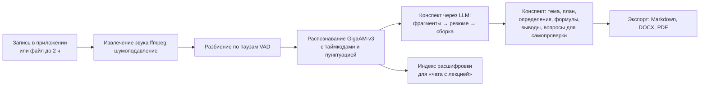
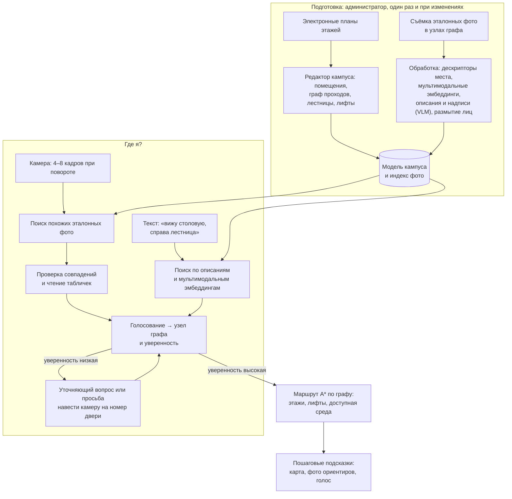

# Этап 3. Второстепенные функции (R1.1 → R2.0 → R2.1 → R3)

**Сроки:** 08.02 – 29.08.2027, дальше — R3 · Идёт параллельно с [поддержкой пилота](04-stage-4-support.md)

← [Первый релиз](02-stage-2-release-1.md) · [К плану](README.md) · Следующий этап: [Поддержка →](04-stage-4-support.md)

## Обзор

| Релиз | Сроки | Главное | Почему в это время |
|---|---|---|---|
| **R1.1** | 08.02 – 21.03.2027 (S5–S7), релиз 22.03 | Конспекты лекций, Linux, уведомления, VAD, база знаний вуза. Параллельно — прототип навигации | Середина семестра, копятся лекции; пилот даёт первую обратную связь |
| **R2.0** | 22.03 – 30.05.2027 (S8–S12), релиз 31.05 | Навигатор в пилотном корпусе, голос без рук, курсы преподавателей | До летней сессии; навигатор проверяем до наплыва первокурсников |
| **R2.1** | 31.05 – 29.08.2027, релиз 30.08 | Все корпуса, режим первокурсника, перенесённые задачи, подготовка к масштабированию | 1 сентября — пик потребности в навигации |
| **R3.x** | с сентября 2027 | Весь вуз или несколько вузов, iOS, вход через ЛК вуза, LMS | По итогам пилота и переговоров |

**Ёмкость.** После выхода R1 на поддержку уходит 20–25% времени команды: дежурства, исправления, работа с пилотом.

| Релиз | Расчёт | Доступно для функций | План |
|---|---|---|---|
| R1.1 | 4 чел. × 30 дн. × 0,7 × 0,75 | ≈ 63 ч/д | 56,5 ч/д |
| R2.0 | 4 чел. × 46 дн. × 0,7 × 0,8 (с учётом майских праздников) | ≈ 103 ч/д | 95,5 ч/д |

---

## R1.1 — «Конспекты и Linux» (релиз 22.03.2027)

### Цель

Студент записывает лекцию или загружает файл и получает структурированный конспект. Образец — сервис «Буквица»: расшифровка и конспект с главными мыслями. Отличия «Думыча»:

- обработка только на своём сервере;
- конспект связан с чатом и документами.

Дополнительно:

- версия для Linux, включая российские ОС в вузах;
- уведомления об изменениях расписания;
- более качественный голосовой ввод.

### Конвейер конспекта

**Ограничения пилота.** Лекция — до 2 ч и 500 МБ. На пользователя — до 10 ч аудио в месяц. Аудио по умолчанию удаляется сразу после распознавания. Задачи конспектов обрабатываются с приоритетом ниже чата.

**Качество.** На 10 эталонных лекциях:

- эксперт отмечает, что в конспекте есть ≥ 80% ключевых тем;
- не больше одной фактической ошибки на конспект;
- конспект часовой лекции готов за ≤ 15 мин.

### Эпики и задачи R1.1

| ID | Задача | Роль | ч/д |
|---|---|---|---|
| **E11. Конспекты лекций** | | | **21,5** |
| R1.1-E11-01 | Загрузка аудио и видео (mp3, m4a, wav, ogg, opus, mp4, webm), извлечение звука | Р1 | 1,5 |
| R1.1-E11-02 | Запись лекции в приложении. Android: фоновая запись (foreground service с уведомлением), пауза, загрузка частями. ПК: выбор микрофона | Р2 | 4 |
| R1.1-E11-03 | Длинное распознавание: сегментация по VAD, таймкоды, пунктуация, очередь с приоритетами | Р3 | 3 |
| R1.1-E11-04 | Генерация конспекта: конвейер «фрагменты → резюме → сборка» (Р1, 2 ч/д), шаблоны «подробно», «кратко», «глоссарий», «вопросы для самопроверки», формулы в LaTeX, ссылки на таймкоды (Р3, 2 ч/д) | Р1, Р3 | 4 |
| R1.1-E11-05 | «Чат с лекцией»: расшифровка индексируется в RAG, ответы со ссылками на таймкоды | Р1 | 1,5 |
| R1.1-E11-06 | Экспорт в Markdown, DOCX, PDF | Р1 | 1,5 |
| R1.1-E11-07 | Клиент: экран лекций, прогресс обработки, просмотр конспекта, переход по таймкоду с воспроизведением, экспорт и «Поделиться» | Р2 | 4 |
| R1.1-E11-08 | Правила: запись только с разрешения преподавателя, удаление аудио после обработки, квоты | Р1 | 0,5 |
| R1.1-E11-09 | Оценка качества на 10 лекциях | Р3 | 1,5 |
| **E12. Linux-версия** | | | **4** |
| R1.1-E12-01 | Сборка deb, rpm и AppImage; автообновление; проверка записи звука; тесты на Astra Linux SE 1.8, ALT p11, РЕД ОС 8 | Р4 (3), Р2 (1) | 4 |
| **E13. Уведомления об изменениях расписания** | | | **3** |
| R1.1-E13-01 | Сравнение версий расписания на сервере, API изменений | Р1 | 1 |
| R1.1-E13-02 | Фоновая проверка (Android WorkManager), локальные уведомления, уведомления в трее на ПК. Без Google FCM | Р2 | 2 |
| **E14. Голосовой ввод: качество** | | | **3** |
| R1.1-E14-01 | Silero VAD на устройстве (ONNX): запись останавливается после паузы, тишина не отправляется | Р2 | 1,5 |
| R1.1-E14-02 | Шумоподавление на сервере (DeepFilterNet) для голоса и лекций | Р3 | 1,5 |
| **E15. База знаний вуза** | | | **3** |
| R1.1-E15-01 | Администратор загружает положения, FAQ, контакты служб; общий индекс; инструмент `university_info` со ссылками на источники | Р1 (1), Р4 (1,5), Р3 (0,5) | 3 |
| **E16. Удобство и приватность** | | | **4** |
| R1.1-E16-01 | Расписание преподавателя: выбор хранится только на устройстве | Р2 (1), Р1 (0,5) | 1,5 |
| R1.1-E16-02 | PPTX и сканы (OCR) в RAG | Р1 | 1,5 |
| R1.1-E16-03 | Автомаскирование ПД в сохраняемой истории: телефоны, e-mail, паспорт, СНИЛС, ИНН, номера карт (регулярные выражения + NER Natasha/Slovnet) | Р3 | 1 |
| **E17. Прототип навигации** — см. [раздел ниже](#прототип-навигации-в-r11) | Р3 (5), Р4 (4), Р2 (1) | | **10** |
| **E18. Улучшения по итогам пилота (резерв)** | Р1, Р2, Р3, Р4 — по 2 | | **8** |
| | **Итого R1.1** | | **56,5** |

Нагрузка по ролям: Р1 — 13, Р2 — 16,5, Р3 — 16,5, Р4 — 10,5 ч/д. Ёмкость каждого — около 15,75 ч/д. Р4 берёт на себя основную часть поддержки и эксплуатации.

### Прототип навигации в R1.1

Задача — до 19.03.2027 проверить на одном этаже пилотного корпуса, что местоположение по фото определяется с нужной точностью. Это решающий технический риск R2.

| Шаг | Что делаем | Кто | Когда |
|---|---|---|---|
| 1 | Оцифровываем граф проходов 1–2 этажей по электронным планам. Временный инструмент — скрипт или простая форма | Р4 | S6 |
| 2 | Снимаем эталонные фото: в каждом узле графа 8 кадров по кругу на уровне глаз, днём и вечером. Людей в кадре нет, лица размываются | Р4, Р3, волонтёры | S6 |
| 3 | Базовая локализация: глобальные дескрипторы места (MegaLoc) → кандидаты → голосование по нескольким кадрам | Р3 | S6–S7 |
| 4 | Улучшения: проверка совпадений локальными признаками (LightGlue), чтение номеров дверей и табличек через VLM | Р3 | S7 |
| 5 | Испытание: 100 попыток «где я?» в разных точках и при разном освещении, замер точности и времени | Р3, Р2 | S7 |

**Критерии решения 19.03.2027:**

- верный узел с первой попытки (Top-1) — ≥ 80%;
- верный узел среди трёх вариантов (Top-3) — ≥ 95%;
- время ответа p95 ≤ 5 с.

**Если критерии не выполнены**, берём запасной подход и согласуем его с вузом:

- QR-метки в ключевых точках коридоров (их распознавание почти безошибочно);
- «Где я?» через выбор ближайшей аудитории на карте;
- камера остаётся только для чтения номеров дверей.

---

## R2.0 — «Навигатор и голос без рук» (релиз 31.05.2027)

### Цель

Три направления:

- **Навигатор в пилотном корпусе.** Пользователь поворачивает камеру или описывает, что видит. «Думыч» определяет место и ведёт до аудитории по шагам: с картой этажа, фото ориентиров и голосом.
- **Голос без рук.** «Думыч» вызывается словом.
- **Курсы преподавателей.** Преподаватель публикует материалы курса, студенты задают по ним вопросы.

### Как работает навигатор

**Данные кампуса.**

- **Граф.** Электронные планы этажей загружаются в редактор и привязываются к масштабу. Узлы ставятся каждые 5–10 м коридора, на развилках, у дверей, лестниц и лифтов. У рёбер есть длина и признаки: ступени, лифт, пандус, время работы прохода.
- **Точки интереса.** Столовая, библиотека, гардероб, деканаты, туалеты.
- **Объём съёмки.** На этаж — 40–60 узлов, 300–500 фото, около 1 ч съёмки одним человеком и 0,5 ч проверки. Пятиэтажный корпус — примерно 1 рабочий день.

**Определение места по камере.** Пользователь медленно поворачивается. Приложение само берёт 4–8 резких и непохожих кадров (по метрике размытия и гироскопу) и отправляет их в 1024 px, это около 150 КБ на кадр. На сервере:

1. Для каждого кадра ищутся топ-20 похожих эталонных фото по дескриптору места.
2. Совпадения проверяются по локальным признакам (число согласованных точек).
3. Номера дверей и надписи на табличках, распознанные VLM, сильно повышают вес кандидата.
4. Кадры голосуют за узел с учётом соседства в графе. По углу съёмки совпавшего фото определяется, куда смотрит пользователь.
5. Если уверенность ниже порога, «Думыч» задаёт уточняющий вопрос с миниатюрами («Вы рядом с 305 или 307?») или просит навести камеру на номер ближайшей двери.

**Определение места по описанию.**

1. LLM извлекает из текста ориентиры: номера аудиторий, «лестница», «столовая», «стенд кафедры».
2. Гибридный поиск идёт по описаниям узлов (подписи VLM, теги точек интереса) и по мультимодальным эмбеддингам (текст ↔ фото).
3. Кандидаты сужаются одним-двумя уточняющими вопросами.

**Маршрут и подсказки.**

- **Маршрут.** A* по графу; штрафы за лестницы в режиме доступной среды.
- **Инструкции.** Путь сжимается в отрезки с ориентирами: «пройдите 30 м до лестницы, поднимитесь на 3 этаж, поверните налево, 305 — четвёртая дверь справа». Текст инструкций строится по шаблону, LLM выравнивает формулировки на RU/EN.
- **Пошаговый режим.** Карточки с фото ориентиров из базы эталонных снимков и голосовые подсказки. На контрольных точках местоположение можно уточнить камерой.
- **Связь с расписанием.** «Как пройти на следующую пару?» — аудитория берётся из расписания.

**Сопровождение.**

- Пользователь может нажать «здесь всё изменилось» — создаётся задача администратору.
- После ремонтов изменённые узлы переснимаются.
- Эталонные фото обновляются раз в год.

**Целевые метрики в пилотном корпусе:**

- по камере: Top-1 ≥ 85%, Top-3 ≥ 97%;
- по описанию: верное место с не более чем одним уточнением в ≥ 70% случаев;
- место определяется за ≤ 5 с (p95);
- ≥ 90% испытателей доходят до аудитории без посторонней помощи.

### Голос без рук

- **Слово активации «Думыч».** Работает на устройстве; звук до слова никуда не отправляется.
  - Модель обучается на своих данных (openWakeWord или microWakeWord): синтетика от нашего TTS и 300–500 записей добровольцев с их согласия.
  - Метрики: ложные срабатывания ≤ 1 за 10 ч фоновой речи; пропуски ≤ 5%.
- **Android.**
  - Режим «Голос без рук» включается пользователем, пока приложение на экране. Дальше работает foreground service с постоянным уведомлением.
  - Расход батареи — цель ≤ 2% в час.
  - Пользователю даются инструкции, как добавить приложение в исключения оптимизации батареи у разных производителей.
- **Дуплексный диалог.**
  - Конец реплики определяется по паузам и модели Smart Turn v3.
  - Пользователь может перебить озвучку голосом; работает эхоподавление (источник звука VOICE_COMMUNICATION).
  - Частичная расшифровка показывается во время речи.
  - Целевая задержка — ≤ 1,5 с (p95).
- **ПК.** Фоновое прослушивание в трее — в R2.1.

### Курсы преподавателей

1. Преподаватель создаёт курс и выдаёт группам код курса. Роль преподавателя подтверждается кодом от кафедры или вуза, без ПД.
2. Преподаватель загружает материалы курса. Студенты курса получают ответы по ним со ссылками.
3. По материалам генерируются вопросы для самопроверки и тесты с ответами и ссылками на источник. Экспорт в DOCX и Moodle XML.

### Эпики и задачи R2.0

| ID | Задача | Роль | ч/д |
|---|---|---|---|
| **E19. Навигатор** | | | **58** |
| R2-E19-01 | Модель данных кампуса: корпуса, этажи, помещения, точки интереса, граф, привязка фото | Р1 | 2 |
| R2-E19-02 | Редактор кампуса в админке: загрузка планов (PDF, PNG, SVG), масштаб и привязка, рисование графа, помещения и точки интереса, проверка связности | Р4 | 8 |
| R2-E19-03 | Режим съёмки в приложении (роль «администратор»): выбор узла на карте, серия кадров по кругу, загрузка | Р2 | 4 |
| R2-E19-04 | Обработка эталонных фото: дескрипторы (MegaLoc), мультимодальные эмбеддинги (Qwen3-VL-Embedding), подписи и надписи (VLM), размытие лиц, индекс | Р3 (3), Р4 (2) | 5 |
| R2-E19-05 | Определение места по камере: поиск, проверка совпадений, голосование кадров, оценка уверенности, уточняющий вопрос | Р3 | 8 |
| R2-E19-06 | Определение места по описанию: извлечение ориентиров, гибридный поиск, уточняющий диалог | Р1 (3), Р3 (1) | 4 |
| R2-E19-07 | Маршрутизация: A* с переходами между этажами, режим доступной среды, инструкции с ориентирами, связь с расписанием | Р1 | 4 |
| R2-E19-08 | Клиент: карта этажа (масштаб, этажи), маршрут, пошаговый режим, фото ориентиров, голосовые подсказки | Р2 | 10 |
| R2-E19-09 | Клиент: «Где я?» — камера, подсказки по съёмке, выбор из вариантов | Р2 | 3 |
| R2-E19-10 | Оцифровка всего пилотного корпуса и съёмка эталонных фото (плюс волонтёры) | Р4 (2), Р3 (2) | 4 |
| R2-E19-11 | Полевые испытания (200 попыток) и донастройка порогов | Р3 (2), Р2 (1), Р4 (1) | 4 |
| R2-E19-12 | Инструмент `navigate` в чате и голосе: «Как пройти в 305?» | Р1 | 2 |
| **E20. Голос без рук** | | | **16,5** |
| R2-E20-01 | Модель слова активации: сбор записей, обучение, замер ложных срабатываний и пропусков | Р3 (3), Р4 (2) | 5 |
| R2-E20-02 | Android: сервис активации, энергопотребление, исключения оптимизации у производителей | Р2 | 4 |
| R2-E20-03 | Дуплекс: конец реплики, перебивание, частичная расшифровка (потоковая модель — GigaAM или T-one) | Р1 (2), Р3 (2), Р2 (1,5) | 5,5 |
| R2-E20-04 | Автоопределение языка речи; коррекция терминов по словарю курса и документов пользователя | Р3 | 1 |
| R2-E20-05 | Вход на ПК по QR: телефон подтверждает вход | Р1 (0,5), Р2 (0,5) | 1 |
| **E21. Для преподавателей** | | | **13** |
| R2-E21-01 | Курсы: создание, код курса, присоединение групп | Р1 (2), Р2 (2) | 4 |
| R2-E21-02 | Материалы курса: общий индекс курса, ответы студентам со ссылками | Р1 (1,5), Р3 (1), Р2 (1,5) | 4 |
| R2-E21-03 | Вопросы для самопроверки и тесты по материалам, экспорт в DOCX и Moodle XML | Р3 (1), Р1 (2) | 3 |
| R2-E21-04 | Подтверждение роли преподавателя кодами кафедры или вуза | Р1 (1), Р4 (1) | 2 |
| **E22. Конспекты: лекция + слайды** | | | **3** |
| R2-E22-01 | Загрузка презентации (PDF, PPTX) вместе с записью; конспект с привязкой к слайдам | Р1 (2), Р3 (1) | 3 |
| **E23. Инфраструктура и качество** | | | **5** |
| R2-E23-01 | Нагрузочный тест под профиль R2, мониторинг навигации и голоса без рук | Р4 | 3 |
| R2-E23-02 | Оценка новых версий моделей, переход на потоковую озвучку | Р3 | 2 |
| | **Итого R2.0** | | **95,5** |

Нагрузка по ролям: Р1 — 22, Р2 — 27,5, Р3 — 27, Р4 — 19 ч/д. Ёмкость — около 25,8 ч/д на человека. Клиент и ML загружены выше ёмкости. При отставании в R2.1 переносятся, по порядку:

1. перебивание голосом (R2-E20-03, частично);
2. тесты и экспорт в Moodle (R2-E21-03);
3. лекция + слайды (R2-E22-01).

Навигатор не сокращается.

**Критерии приёмки R2.0:**

- метрики навигатора в пилотном корпусе достигнуты;
- слово активации проходит пороги ложных срабатываний и пропусков на 5 моделях Android;
- преподаватель создаёт курс и публикует материалы, студент получает ответ по ним со ссылкой.

---

## R2.1 — «Весь кампус к 1 сентября» (релиз 30.08.2027)

Летом ёмкость ниже: в июне сессия, в июле отпуска. Планируем около 50% обычной.

| Эпик | Содержание | ≈ ч/д |
|---|---|---|
| E24. Оцифровка кампуса | Граф и эталонные фото всех корпусов. Около 1 дня съёмки на корпус на двух человек плюс обработка. Переходы между корпусами — по карте кампуса (OpenStreetMap, ODbL, с атрибуцией) и GPS | 10–20 |
| E25. Режим первокурсника | «Экскурсия» по кампусу, быстрые запросы «где деканат, столовая, библиотека», подсказки в первые недели | 6 |
| E26. Перенесённое из R2.0 | Фоновое прослушивание на ПК, разделение конспекта по говорящим (диаризация — сначала проверить лицензии весов), публикация конспекта для группы с разрешения преподавателя, а также всё, что было сокращено в R2.0 | 10–15 |
| E27. Подготовка к масштабу | Нагрузочные тесты на 5–15 тыс. пользователей, план перехода на конфигурацию «Вуз», k3s — только при необходимости | 6 |
| E28. macOS (по запросу) | Сборка, подписание, тестирование | 4 |
| E29. Обновление моделей | Ежеквартальный пересмотр (см. [Этап 4](04-stage-4-support.md#5-жизненный-цикл-моделей)) | 3 |

Плюс сезонная подготовка к учебному году: импорт расписания, новые коды, проверка навигации после летних ремонтов. См. [календарь операций](04-stage-4-support.md#8-сезонные-операции).

---

## R3.x — бэклог развития (с сентября 2027)

Приоритеты пересматриваются по итогам пилота.

| Приоритет | Функция | Условие |
|---|---|---|
| 1 | Масштабирование на весь вуз (5–15 тыс.), конфигурация «Вуз» | Решение вуза, метрики пилота |
| 2 | Вход через ЛК вуза: OIDC с псевдонимным идентификатором, вуз передаёт только роль и группу | Партнёрство с вузом |
| 3 | Установка на сервере вуза: пакет Ansible и Compose, документация | Запрос вуза |
| 4 | Несколько вузов: отдельная установка на вуз или общий сервер с изоляцией | Коммерческий запуск |
| 5 | iOS и веб-версия (Flutter) | Спрос пользователей |
| 6 | Интеграция с LMS (Moodle): курсы и материалы | Согласие вуза |
| 7 | AR-подсказки навигатора поверх камеры | Удачный опыт R2 |
| 8 | Офлайн-режим на ПК: компактная модель (2–4B) локально для базовых вопросов | Запрос пользователей |
| 9 | Монетизация: лицензия для вузов, расширенные квоты; коммерческие лицензии моделей при необходимости (например, Silero TTS) | Решение о коммерциализации |
| 10 | Агрегированная аналитика для преподавателя: частые вопросы по курсу без ПД | Курсы в R2 |
| 11 | Дополнительные языки интерфейса для иностранных студентов | Спрос |
