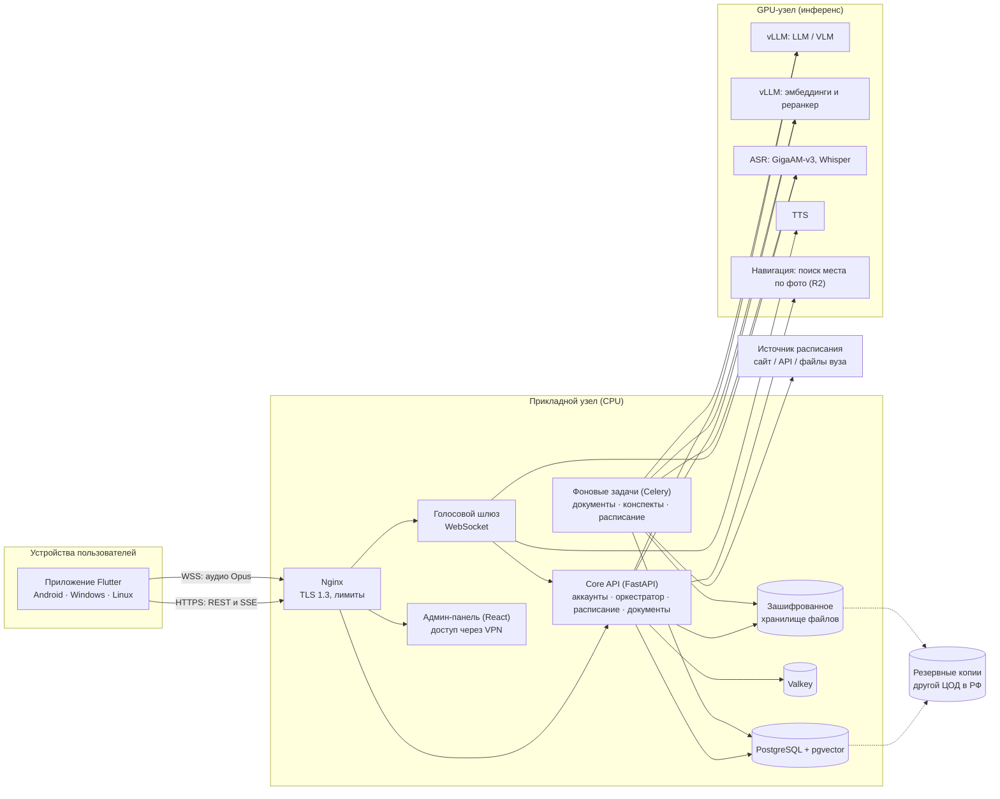
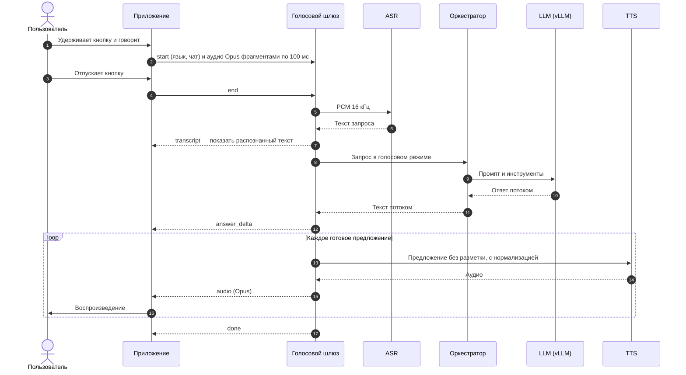
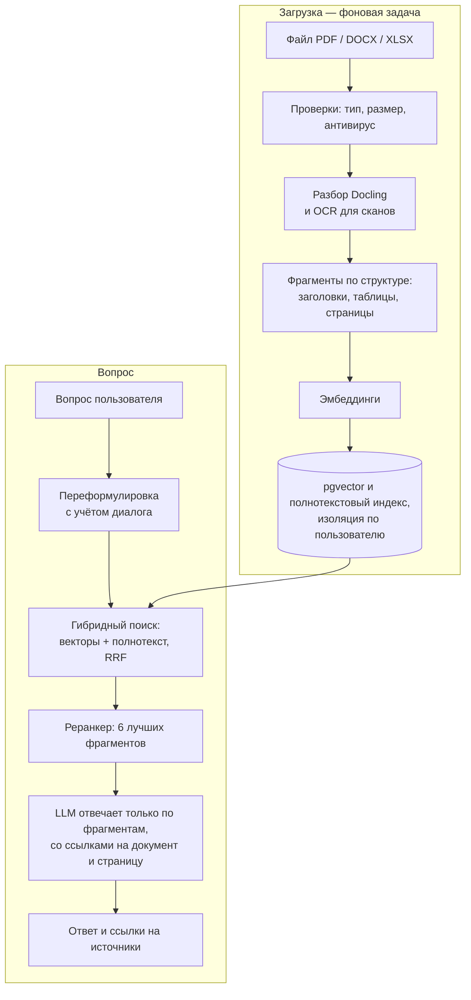
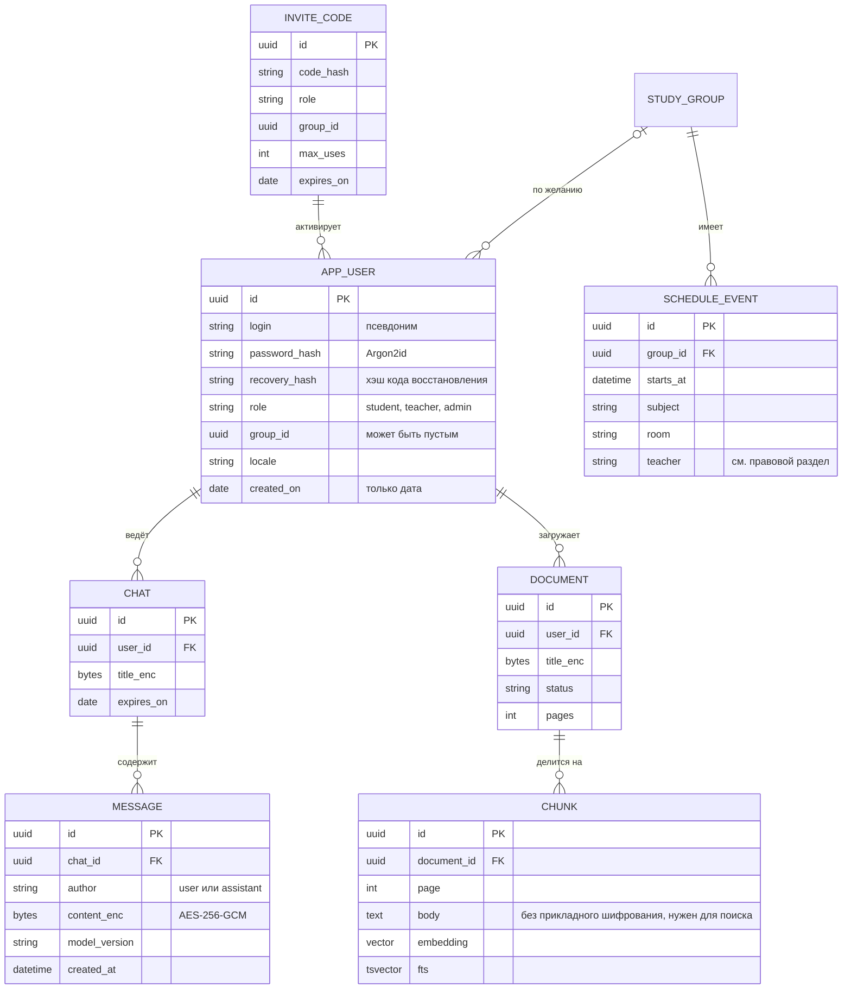

# Архитектура и технологический стек

← [К плану](README.md) · Связанные документы: [требования к серверу](06-server-requirements.md), [регистрация и данные](07-privacy-and-registration.md)

## 1. Принципы

1. **Тонкий клиент, тяжёлый сервер.**
   - На устройстве: интерфейс, запись и воспроизведение звука, кэш и крошечные модели (VAD, слово активации).
   - На GPU-сервере: всё, что требует вычислений.

   Поэтому приложение лёгкое и на бюджетном смартфоне, и на старом ПК.
2. **Приватность по умолчанию.** Нет персональных данных, внешних ИИ-API, сторонних SDK аналитики и рекламы. Данные шифруются, логи минимальны.
3. **Только открытые компоненты, которые можно использовать в коммерческом продукте**: Apache-2.0, MIT, BSD, PostgreSQL License. Код под GPL/AGPL используем только как отдельные сервисы без изменений и без распространения клиентам: ClamAV, Grafana, Loki.
4. **Модели заменяемы.** Каждая модель спрятана за своим API: OpenAI-совместимым у vLLM или внутренним. Смена модели — это смена конфигурации плюс прогон оценочных наборов.
5. **Сначала один узел, потом масштаб.** Docker Compose на одном сервере, затем отдельные узлы, затем k3s — без переписывания кода.
6. **Модульный монолит.** Core API — один сервис с чёткими модулями. Тяжёлые ИИ-функции вынесены в отдельные сервисы.

## 2. Компоненты



В пилоте на конфигурации А прикладной и GPU-узел — один физический сервер. На конфигурации Б они разделены (см. [требования к серверу](06-server-requirements.md)).

## 3. Клиент

| Область | Выбор | Почему |
|---|---|---|
| Фреймворк | **Flutter 3.x (Dart)**, нативная AOT-компиляция под ARM и x64 | Одна кодовая база для Android, Windows, Linux, а позже macOS, iOS и веба. Приложение лёгкое, плагины для аудио и камеры зрелые |
| Состояние и DI | Riverpod | Тестируемость, без лишнего кода |
| Навигация | go_router | Deep links для кодов приглашения (`doomich://invite/…`) |
| Сеть | dio (REST, SSE), web_socket_channel (голос) | Стриминг ответов, повторы, pinning сертификата |
| Локальная БД | drift (SQLite) | Офлайн-кэш расписания и истории |
| Секреты | flutter_secure_storage | Android Keystore, Windows Credential Manager, libsecret |
| Аудио | record (захват, Opus), just_audio (воспроизведение) | Единый API на всех платформах |
| ML на устройстве | onnxruntime: Silero VAD (R1.1), модель слова активации (R2) | Модели по 1–2 МБ, нагрузка на CPU — единицы процентов |
| Камера | camera (R2) | Кадры для «Где я?» |
| Отображение ответов | Markdown, формулы LaTeX (flutter_math_fork), подсветка кода | Формулы и код в учебных ответах |
| Локализация | flutter gen-l10n (ARB), RU/EN | Проверка полноты переводов в CI |
| Темы | Material 3: светлая, тёмная, системная | — |
| Ошибки | SDK, совместимый с Sentry, отправляет на свой GlitchTip без IP и ПД | Без сторонних облаков |
| Распространение | Android: RuStore и APK. Windows: Inno Setup и автообновление. Linux: deb, rpm, AppImage | Работа без Google Play Services |

**Почему не другие варианты:**

- **Electron** потребляет 300+ МБ RAM — противоречит требованию «ненагруженно».
- **Kotlin Multiplatform с Compose Desktop** на ПК работает на JVM, это лишняя память.
- **Tauri 2** лёгкий, но его мобильная часть, аудио и камера менее зрелые.
- **Нативные приложения** — это 2–3 кодовые базы, неподъёмно для команды из 3–5 человек.

**Бюджеты клиента:**

- APK ≤ 30 МБ, установка на Windows ≤ 80 МБ;
- RAM ≤ 200 МБ;
- холодный старт ≤ 2 с;
- в простое CPU не нагружается.

Трафик:

- голос — около 3 КБ/с (Opus 24 кбит/с);
- кадр для навигации — около 150 КБ.

## 4. Сервер

| Область | Выбор |
|---|---|
| Язык и фреймворк | Python 3.12, FastAPI, Pydantic v2, SQLAlchemy 2, Alembic |
| Фоновые задачи | Celery и Valkey (форк Redis под лицензией BSD) |
| БД | PostgreSQL 17, pgvector (HNSW), полнотекстовый поиск (`russian`, `english`), Row-Level Security |
| Файлы | Раздел с шифрованием LUKS и прикладное шифрование AES-256-GCM с ключом на пользователя |
| Прокси | Nginx: TLS 1.3, HTTP/2, лимиты запросов |
| Инференс LLM, эмбеддингов, реранкера | **vLLM**: OpenAI-совместимый API, непрерывный батчинг |
| Распознавание речи | GigaAM-v3 (через sherpa-onnx или PyTorch), Whisper large-v3-turbo (faster-whisper) |
| Синтез речи | Модель по итогам бенчмарка, отдельный сервис со своим API |
| Разбор документов | Docling; OCR — Tesseract (rus+eng) или RapidOCR; антивирус ClamAV |
| Админ-панель | React, TypeScript, Ant Design (Refine для CRUD). Для команды из трёх человек в R1 — SQLAdmin |
| Наблюдаемость | Prometheus, Grafana, Loki, GlitchTip, Uptime Kuma |
| Развёртывание | Docker Compose, Ansible, GitHub Actions, Trivy; секреты — SOPS + age |

## 5. Модели

Кандидаты указаны по состоянию на ноябрь 2026. Окончательный выбор — по [бенчмарку в Спринте 0](01-stage-1-design.md#5-выбор-моделей-бенчмарк).

| Задача | Основной кандидат | Альтернативы | Лицензия | Память GPU (оценка) | С какого релиза |
|---|---|---|---|---|---|
| LLM: диалог, инструменты, RAG, чтение надписей на фото | Qwen3.6-35B-A3B (MoE, 3B активных параметров, нативный ввод изображений) | Qwen3.8-27B (плотная); Qwen3.5-9B для конфигурации А; GigaChat 3 Lightning 10B-A1.8B (российская) | Apache-2.0; GigaChat — MIT | ≈ 20 ГБ в 4 бит или ≈ 36 ГБ в FP8, плюс KV-кэш | R1 |
| Распознавание русской речи | GigaAM-v3 | T-one (потоковая, для частичной расшифровки) | MIT; T-one — Apache-2.0 | 1–2 ГБ | R1 |
| Распознавание английской речи | Whisper large-v3-turbo | — | MIT | 2–3 ГБ | R1 |
| Синтез речи RU/EN | По бенчмарку: Qwen3-TTS, ESpeech-TTS-1, Kokoro-82M, Chatterbox Multilingual | Silero TTS — только по коммерческой лицензии авторов | Apache-2.0 / MIT | 0,5–5 ГБ | R1 |
| Нормализация текста для TTS | Свои правила, NeMo text processing, словарь ударений | — | Apache-2.0 | CPU | R1 |
| Эмбеддинги | Qwen3-Embedding-0.6B | BGE-M3 | Apache-2.0 / MIT | ≈ 1,5 ГБ | R1 |
| Реранкер | Qwen3-Reranker-0.6B | bge-reranker-v2-m3 | Apache-2.0 | ≈ 1,5 ГБ | R1 |
| Разбор документов и OCR | Docling, Tesseract, RapidOCR | — | MIT / Apache-2.0 | CPU | R1 |
| VAD | Silero VAD (на устройстве) | — | MIT | CPU, ≈ 2 МБ | R1.1 |
| Шумоподавление | DeepFilterNet | RNNoise | MIT/Apache-2.0 / BSD | CPU или GPU | R1.1 |
| Маскирование ПД в истории | Регулярные выражения и NER Natasha/Slovnet | — | MIT | CPU | R1.1 |
| Поиск места по фото | MegaLoc (на основе DINOv2) | — | MIT (DINOv2 — Apache-2.0) | ≈ 1 ГБ | R2 |
| Поиск «текст ↔ фото» | Qwen3-VL-Embedding-2B | — | Apache-2.0 | ≈ 5 ГБ | R2 |
| Проверка совпадений | LightGlue с ALIKED или XFeat; SuperPoint нельзя — его лицензия некоммерческая | — | Apache-2.0 / BSD (проверить) | ≈ 1 ГБ | R2 |
| Слово активации | Своя модель «Думыч» (openWakeWord или microWakeWord) | Поиск ключевых слов в sherpa-onnx | Apache-2.0 (код), модель наша | На устройстве | R2 |
| Определение конца реплики | Smart Turn v3 | — | BSD-2-Clause | CPU | R2 |
| Разделение по говорящим | pyannote.audio или NeMo — проверить лицензии весов | — | — | GPU | R2.1 |

Лицензии всех компонентов фиксируются в `THIRD_PARTY_NOTICES` и проверяются в CI. Модели с некоммерческими лицензиями (Silero TTS, XTTS-v2, F5-TTS-ru, SuperPoint) не используются. Если подзаконные акты по 243-ФЗ потребуют «национальные» модели, LLM меняется на GigaChat, остальной код не трогаем.

## 6. Потоки данных

### 6.1 Текстовый чат

1. Клиент отправляет `POST /v1/chats/{id}/messages`.
2. Оркестратор собирает контекст: системный промпт, сжатую историю и инструменты (`get_schedule`, `search_documents`, `university_info`, позже `navigate`).
3. vLLM генерирует ответ, при необходимости вызывая инструменты.
4. Ответ идёт клиенту потоком через SSE.
5. Сообщение шифруется и сохраняется, если это не «инкогнито». Вместе с ним сохраняется версия модели.

### 6.2 Голос (R1: «нажми-и-говори»)



Аудио обрабатывается только в памяти и не записывается на диск.

**Бюджет задержки (p95):**

| Этап | Время |
|---|---|
| Доставка последнего фрагмента | 0,1 с |
| Распознавание фразы до 10 с | 0,3 с |
| Первый токен LLM | 0,6 с |
| Первое предложение | 0,5 с |
| Первый аудиофрагмент TTS | 0,5 с |
| Доставка и начало воспроизведения | 0,2 с |
| **Итого** | **≈ 2,2 с** |

Цель R1 — ≤ 2,5 с. В R2 переходим на потоковое распознавание и синтез и целимся в ≤ 1,5 с.

### 6.3 Ответы по документам (RAG)



Защита от промпт-инъекций:

- текст документов попадает в промпт как данные в явных разделителях;
- инструкции из документов не исполняются;
- вызовы инструментов проходят проверку схемой.

### 6.4 Конспекты (R1.1) и навигация (R2)

Схемы и описание — в [Этапе 3](03-stage-3-secondary-features.md#конвейер-конспекта): [конвейер конспекта](03-stage-3-secondary-features.md#конвейер-конспекта) и [навигатор](03-stage-3-secondary-features.md#как-работает-навигатор).

## 7. API (обзор)

REST, JSON, префикс `/v1`. Контракт описан в OpenAPI 3.1, клиент на Dart генерируется из него.

| Группа | Методы |
|---|---|
| Аккаунт | `POST /auth/register`, `/auth/login`, `/auth/refresh`, `/auth/logout`, `/auth/recover`; `GET/PATCH /me`; `DELETE /account` |
| Чаты | `GET/POST/PATCH/DELETE /chats`; `GET /chats/{id}/messages`; `POST /chats/{id}/messages` (ответ потоком SSE); `POST /feedback` |
| Расписание | `GET /groups`; `GET /schedule?group=&from=&to=`; `GET /schedule/changes?since=` (R1.1) |
| Документы | `POST /documents` (multipart); `GET /documents`; `GET /documents/{id}/chunks/{chunk_id}`; `DELETE /documents/{id}` |
| Лекции (R1.1) | `POST /lectures` (загрузка частями); `GET /lectures/{id}`; `GET /lectures/{id}/export?format=docx` |
| Навигация (R2) | `GET /campus/buildings/…`; `POST /nav/locate` (кадры или текст); `POST /nav/route` |
| Курсы (R2) | `POST /courses`; `POST /courses/join`; `POST /courses/{id}/materials`; `POST /courses/{id}/quiz` |
| Голос | `wss://…/v1/voice` — см. ниже |
| Админ-API | `/admin/v1/…`: отдельная аутентификация с TOTP, доступ только через VPN |

**Протокол голосового канала.**

- **Клиент → сервер:** `start {lang, chat_id, mode}`, бинарные кадры Opus, `end`, `cancel`.
- **Сервер → клиент:** `transcript {text, final}`, `answer_delta {text}`, бинарные аудиофрагменты с номером, `done`, `error {code}`.

## 8. Данные



**Компромисс с шифрованием.** Исходные файлы, сообщения и названия шифруются ключом пользователя. Текст фрагментов, векторы и полнотекстовый индекс нужны для поиска, поэтому прикладного шифрования у них нет. Их защищают шифрование диска, Row-Level Security и автотесты изоляции. Это осознанно принятый риск, он записан в модели угроз.

Таблицы R1.1–R2 (лекции, курсы, кампус и граф, эталонные фото) добавляются отдельными миграциями.

## 9. Безопасность

| Мера | Как реализуется |
|---|---|
| Аутентификация | Argon2id; access-токен на 15 мин; refresh-токен на 30 дней с ротацией и отзывом; ограничение попыток входа и восстановления; коды приглашения защищают от массовой регистрации |
| Транспорт | TLS 1.3; pinning сертификата в приложении с резервными пинами |
| Изоляция данных | Row-Level Security в PostgreSQL по `user_id`, автотесты «чужие данные недоступны» |
| Шифрование хранения | LUKS. Плюс ключ данных на пользователя (AES-256-GCM), он зашифрован мастер-ключом, который хранится вне БД |
| ИИ-специфика | Документы — это данные, а не инструкции; белый список инструментов со схемами; лимиты на длину и частоту запросов |
| Администрирование | Отдельные учётные записи, 2FA (TOTP), доступ через WireGuard, журнал действий |
| Логи | Без IP-адресов и содержимого запросов; хранятся 14 дней |
| Цепочка поставок | Фиксированные версии пакетов, проверка хэшей весов моделей, Trivy, Renovate |

## 10. Производительность и масштабирование

Путь роста — без переписывания кода:

1. **Один сервер** (конфигурация А, разработка).
2. **Прикладной узел и GPU-узел отдельно** (конфигурация Б, пилот).
3. **Несколько GPU-узлов** за балансировщиком с репликами vLLM; отдельный узел для речи (конфигурация В, весь вуз).
4. **Kubernetes (k3s)** — при нескольких вузах или требованиях отказоустойчивости.

Признаки, что пора переходить на следующую конфигурацию, — в [требованиях к серверу](06-server-requirements.md#7-когда-переходить-на-следующую-конфигурацию).

## 11. Структура репозитория

```text
doomich/
├── apps/
│   ├── client/        # Flutter: Android, Windows, Linux
│   └── admin/         # React + TypeScript: админ-панель
├── services/
│   ├── api/           # FastAPI: аккаунты, оркестратор, расписание, документы, голосовой шлюз
│   ├── workers/       # Celery: разбор документов, конспекты, синхронизация расписания
│   ├── asr/           # сервис распознавания речи
│   ├── tts/           # сервис синтеза речи
│   └── nav/           # навигация (R2)
├── ml/
│   ├── evals/         # оценочные наборы и скрипты
│   └── experiments/   # бенчмарки, прототипы
├── infra/
│   ├── ansible/
│   ├── compose/
│   └── monitoring/
└── docs/              # план, ADR, API, регламенты
```

## 12. Окружения и CI/CD

| Окружение | Где | Назначение |
|---|---|---|
| dev | Ноутбуки разработчиков; модельный слой — общий на GPU-сервере (по VPN) | Разработка |
| stage | Отдельный стек приложения на сервере пилота, своя БД | Демо, альфа, приёмка |
| prod | Основной стек | Пилот |

**Конвейер:**

1. PR: линтеры, тесты, сборки.
2. Merge в `main`: образы попадают на stage.
3. Тег `vX.Y.Z`: prod, сборки для магазинов и автообновления.
4. Ночью: оценочные наборы ИИ и отчёт в чат команды.
