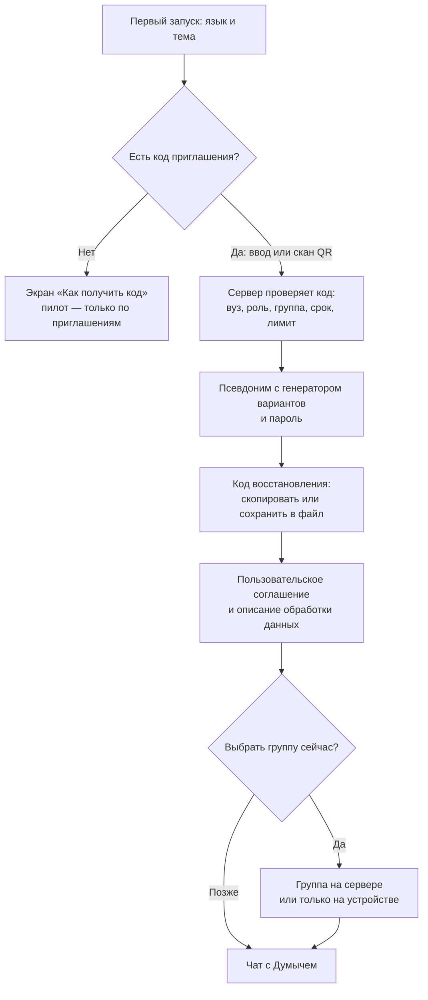

# Регистрация без персональных данных и правовые требования

← [К плану](README.md) · Связанные документы: [архитектура](05-architecture-and-stack.md), [риски](08-risks.md)

> Это не юридическая консультация. Схему нужно подтвердить у юриста в Спринтах 0–1 (вопросы — в [разделе 8](#8-вопросы-юристу)). Обзор норм — по состоянию на ноябрь 2026.

## 1. Принцип

Мы не «обходим» законы. Сервис спроектирован так, чтобы у него **не появлялось оснований обрабатывать персональные данные** (минимизация данных, privacy by design). Тогда не наступает большая часть обязанностей оператора ПД:

- согласия;
- уведомление Роскомнадзора;
- организационные документы оператора.

Правила, не связанные с ПД, всё равно действуют. Например, правила авторизации пользователей (раздел 6).

Персональные данные по 152-ФЗ — это любая информация, прямо или косвенно относящаяся к определённому или определяемому человеку. Отсюда два правила проекта:

1. Не собираем ничего, что идентифицирует человека.
2. Не связываем данные аккаунта с конкретной личностью — ни на сервере, ни в логах.

## 2. Регистрация (R1)

| Элемент | Как устроено | Почему это не ПД |
|---|---|---|
| Код приглашения | Вид `XXXX-XXXX` без похожих символов. Задаёт вуз, роль, при необходимости группу, срок и лимит активаций. Выпускается пачкой на группу или поток | Код не выдаётся конкретному человеку. Одна пачка — на всю группу |
| Псевдоним | 3–24 символа. Генератор предлагает варианты вида «ТихийЕнот42». Если псевдоним похож на имя и фамилию, приложение предупреждает | Пользователь не указывает реальное имя |
| Пароль | От 10 символов, локальная проверка стойкости, на сервере — хэш Argon2id | — |
| Код восстановления | 20 символов (≈ 100 бит), на сервере только хэш. Показывается один раз; после каждого восстановления выдаётся новый | Почта и телефон не нужны |
| Группа | По желанию: на сервере (нужна для курсов и уведомлений) или только на устройстве | Номер группы с псевдонимом не позволяет определить человека. Подтверждает юрист |

**Восстановление и устройства:**

- **Нет почты и телефона**, поэтому доступ восстанавливается только кодом. Если потеряны и пароль, и код, придётся создать новый аккаунт. Это честная цена приватности, и при регистрации мы об этом прямо предупреждаем.
- **Второе устройство:** вход по псевдониму и паролю. С R2.0 на ПК можно войти по QR: телефон подтверждает вход.
- **Удаление аккаунта** — в настройках. Данные сразу удаляются из БД и хранилища, а из резервных копий — при ротации, в течение 30 дней.
- **Passkeys** — в R3, после проверки работы на Android без Google-сервисов.

## 3. Роли и подтверждение преподавателя

- **R1.** Роль задаёт код приглашения. Коды для преподавателей выпускаются отдельными пачками.
- **Без партнёрства с вузом.** Код преподавателя выдаёт команда или кафедра после очной проверки. Документы не собираем и не храним.
- **С партнёрством.** Коды выдаёт кафедра или учебно-методическое управление. В R3 возможен вход через ЛК вуза: вуз передаёт только атрибуты (роль, группа) и псевдонимный идентификатор, уникальный для «Думыча». ФИО не передаётся.
- **Привязка «аккаунт ↔ конкретный преподаватель из расписания»** хранится только на устройстве. Если хранить её на сервере, аккаунт станет идентифицируемым.

## 4. Реестр данных

| Данные | Где | Зачем | Срок | Риск ПД и мера |
|---|---|---|---|---|
| Псевдоним, хэши пароля и кода восстановления, роль | Сервер | Вход | До удаления аккаунта | Нет, если псевдоним не похож на ФИО — UI предупреждает |
| Группа | Сервер (по желанию) или устройство | Расписание, курсы | До удаления | Низкий |
| Язык, тема, выбранный преподаватель | Устройство | Интерфейс и расписание | — | Не попадает на сервер |
| Сообщения чатов | Сервер, зашифрованы ключом пользователя | История | 7, 30 или 90 дней, «не хранить» или «инкогнито» | Пользователь может сам написать ПД — предупреждение, с R1.1 автомаскирование |
| Документы и индекс | Сервер, файлы зашифрованы | Ответы по документам | До удаления или 12 месяцев неактивности | Возможны ПД третьих лиц: запрет в соглашении, удаление по жалобе |
| Аудио голосовых запросов | Только в памяти | Распознавание | Не хранится | Голос не используется для установления личности |
| Записи лекций (R1.1) | Сервер до распознавания | Конспект | Удаляется после обработки (по умолчанию) | Запись только с разрешения преподавателя |
| Кадры камеры (R2) | Только в памяти | Определение места | Не хранятся | Лица не распознаются и не сохраняются |
| Эталонные фото кампуса (R2) | Сервер | Навигация | Постоянно | Снимаем без людей, лица размываются автоматически |
| Технические логи | Сервер | Надёжность | 14 дней | Без IP-адресов и содержимого запросов |
| Метрики продукта | Сервер | Решения о развитии | Агрегаты — 13 месяцев | Только агрегаты |
| Ошибки приложения | Свой GlitchTip | Исправление ошибок | 30 дней | Без IP, рекламного ID и содержимого |

## 5. Технические меры

- **Нет сторонних SDK:** Firebase, AppMetrica, Google Analytics, рекламные сети. Идентификаторы устройств не уходят третьим лицам. Push-уведомления — без Google FCM: фоновая проверка и локальные уведомления.
- **Голос и кадры камеры** обрабатываются только в памяти и не записываются на диск. Это проверяется ревью кода и тестом.
- **Шифрование:**
  - TLS 1.3 с pinning сертификата;
  - LUKS на сервере;
  - прикладное шифрование сообщений, названий и файлов ключом пользователя.

  Компромисс для поискового индекса описан в [архитектуре](05-architecture-and-stack.md#8-данные).
- **Хранение:**
  - режим «инкогнито»;
  - срок хранения истории на выбор пользователя;
  - кнопка «удалить все мои данные».
- **Подсказки в интерфейсе:** не вводите паспортные данные, телефоны и данные других людей. С R1.1 — автомаскирование телефонов, e-mail, паспортов, СНИЛС, ИНН и номеров карт в сохраняемой истории.
- **Логи:** без IP-адресов и содержимого. Ограничение частоты запросов использует IP только в памяти.
- **Внутренние метрики** — только агрегаты. Удержание считается по псевдонимному ID без связи с личностью.

## 6. Правовые требования (обзор)

| Норма | Что требует | Как учитываем |
|---|---|---|
| **152-ФЗ «О персональных данных»** | Если ПД обрабатываются: правовые основания или согласие (с 01.09.2025 — отдельным документом), политика, уведомление РКН, хранение в РФ, меры защиты, уведомление об инцидентах. Штрафы за нарушения и утечки с 2025 года выросли | Архитектура без ПД; серверы в РФ. Комплект документов оператора держим наготове на случай, если юрист сочтёт ПД какие-то данные (IP, переписка, документы) |
| **Правила авторизации** (149-ФЗ в ред. 406-ФЗ, с 01.12.2023) и **закон 2026 года о штрафах** | Авторизация пользователей российских сайтов и приложений — по российскому номеру телефона, через Госуслуги (ЕСИА), ЕБС или иную информационную систему, владелец которой — гражданин РФ или российское юрлицо. По сообщениям СМИ, закон о штрафах принят летом 2026 года, для юрлиц — 500–700 тыс. ₽ | Собственная система входа по псевдониму. Владелец — гражданин РФ или российское юрлицо, серверы в РФ. Никакого входа через Google, Apple или иностранную почту. **Ключевой вопрос юристу:** подпадает ли собственная система под «иную ИС» — большинство комментариев отвечают «да» |
| **243-ФЗ от 26.07.2026 «О поддержке развития технологий ИИ в РФ»** | Рамочный закон, основная часть норм — с 01.03.2027. Вводит суверенные и национальные модели. Правительство может определять случаи, когда допускаются только они; для существующих систем переходный период — до 2032 года. Предусматривает маркировку ИИ-контента | Модели заменяемы, российская (GigaChat) всегда в бенчмарке. Ответы помечаются как сгенерированные ИИ. Храним «паспорт модели» и версию в каждом ответе. Следим за подзаконными актами |
| **Часть 4 ГК РФ** (авторские права) | Лекция — произведение преподавателя | Запись — только с разрешения преподавателя, конспект — для личного использования. Публикует конспект для группы только преподаватель (R2.1) |
| **Лицензии ПО и моделей** | Условия Apache-2.0, MIT и BSD, атрибуция | `THIRD_PARTY_NOTICES`, проверка лицензий в CI. Некоммерческие модели (Silero TTS, XTTS-v2, F5-TTS-ru, SuperPoint) не используем |

### Особый случай: ФИО преподавателей в расписании

ФИО преподавателя — это персональные данные. Общедоступность сама по себе не даёт права их распространять: так с 01.03.2021 по ст. 10.1 152-ФЗ. Варианты:

1. **Есть партнёрство с вузом.** Вуз — оператор и поручает «Думычу» обработку по договору (ч. 3 ст. 6 152-ФЗ). У команды появляются обязанности обработчика: конфиденциальность и меры защиты.
2. **Партнёрства нет:**
   - юрист оценивает, можно ли показывать ФИО из публичного расписания;
   - технический вариант: приложение загружает ФИО прямо с сайта вуза на устройство, а сервер хранит расписание без ФИО;
   - крайний вариант: показывать только дисциплину и аудиторию.

## 7. Документы

| Документ | Когда | Содержание |
|---|---|---|
| Пользовательское соглашение | R1 | Правила использования; запрет загружать чужие ПД и незаконный контент; правила записи лекций; ответы ИИ не гарантируются; порядок удаления; возрастной рейтинг |
| «Какие данные мы обрабатываем» | R1 | Понятное описание реестра данных из раздела 4, даже если ПД нет |
| Соглашение о пилоте с вузом | До беты | Роли сторон, данные (расписание, планы, съёмка), каналы раздачи кодов |
| Договор поручения обработки | Если вуз передаёт ПД, например ФИО | Ч. 3 ст. 6 152-ФЗ |
| Документы оператора ПД | Только если юрист решит, что ПД есть | Политика, отдельное согласие, уведомление РКН, внутренние документы и меры защиты |
| Разрешение на съёмку кампуса | До R1.1 | Для эталонных фото навигации |

## 8. Вопросы юристу

1. Достаточно ли собственной системы входа по псевдониму и паролю для соответствия правилам авторизации (149-ФЗ в ред. 406-ФЗ)? Кто должен быть владельцем ИС: гражданин РФ, ИП или ООО?
2. Являются ли ПД в нашей архитектуре:
   - псевдоним;
   - номер группы;
   - IP-адрес, который обрабатывается в памяти без записи в лог;
   - содержимое чатов;
   - загруженные документы?
3. Нужны ли согласие и уведомление РКН, если ПД не собираются целенаправленно, но пользователь может сам ввести их в чат или документ?
4. Можно ли показывать ФИО преподавателей из публичного расписания вуза? Как это оформить с вузом?
5. Запись лекций студентами и обработка аудио на сервере: что нужно прописать в соглашении?
6. Съёмка коридоров вуза для навигации: какие разрешения нужны?
7. Что 243-ФЗ (с 01.03.2027) требует от нас как от оператора системы ИИ: маркировка, документация, ограничения на иностранные модели в вузах?
8. Есть ли особенности для пользователей 16–17 лет?
9. Какие условия лицензий открытых моделей важны при переходе на платную модель?

## 9. Вариант с вузом-партнёром

- **Роли.** Вуз остаётся оператором ПД своих студентов и сотрудников. «Думыч» получает только неперсональные атрибуты.
- **Вход через ЛК вуза (R3).** OpenID Connect с псевдонимным идентификатором (pairwise subject): вуз выдаёт для «Думыча» постоянный ID, не связанный с другими системами, и атрибуты {роль, группа}. Это удобно — не нужен отдельный пароль — и не создаёт ПД у «Думыча».
- **Установка на сервере вуза (R3).** Данные физически не покидают вуз. См. [требования к серверу](06-server-requirements.md#8-размещение-на-сервере-вуза-r3).
