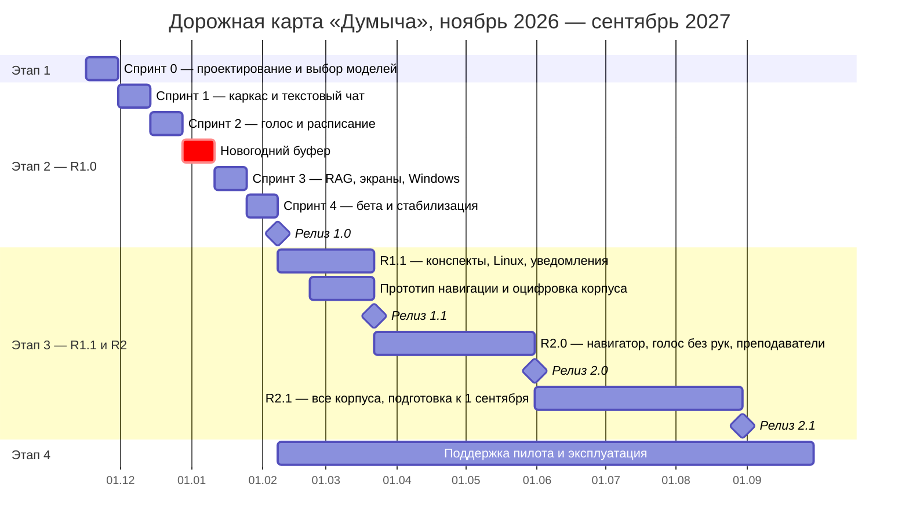

# План проекта «Думыч»

> Рабочий план команды. Версия 1.0 от 15.11.2026. Обновляется на демо в конце каждого спринта.
> Оценки трудозатрат даны в **человеко-днях (ч/д)**. Роли обозначены **Р1–Р4** (см. раздел «Команда»).

## Кратко

«Думыч» — ИИ-ассистент для студентов и преподавателей. Это приложение для Android и ПК (Windows, Linux).
Тяжёлые ИИ-компоненты работают на арендованном GPU-сервере в РФ: языковая модель, распознавание и синтез речи,
поиск по документам, компьютерное зрение для навигации. Внешние ИИ-облака не используются.
Регистрация не требует персональных данных: нужны только псевдоним и пароль.

| Этап | Сроки | Результат |
|---|---|---|
| [1. Проектирование и разбиение на релизы](01-stage-1-design.md) | 16.11 – 29.11.2026 (Спринт 0) | Бэклог R1 с оценками, прототип, архитектура, выбранные модели, сервер и CI |
| [2. Первый релиз R1.0 (MVP)](02-stage-2-release-1.md) | 30.11.2026 – 07.02.2027 (Спринты 1–4) | **08.02.2027** — пилот в вузе на 500 человек: чат текстом и голосом, расписание, ответы по документам |
| [3. Второстепенные функции](03-stage-3-secondary-features.md) | 08.02 – 29.08.2027 (R1.1, R2.0, R2.1) | Конспекты лекций, Linux, навигатор по кампусу, голос без рук, функции преподавателя |
| [4. Поддержка и развитие](04-stage-4-support.md) | с 08.02.2027, постоянно | Эксплуатация, SLA, обновления моделей, сезонные операции |

Сопутствующие документы:

| Документ | Содержание |
|---|---|
| [Архитектура и стек](05-architecture-and-stack.md) | Компоненты, технологии, модели и их лицензии, потоки данных, API, схема данных |
| [Требования к серверу](06-server-requirements.md) | Три конфигурации с ценами аренды, распределение памяти GPU, требования к ПО и провайдеру |
| [Регистрация и правовые вопросы](07-privacy-and-registration.md) | Регистрация без ПД, реестр данных, 152-ФЗ, 406-ФЗ, 243-ФЗ, вопросы юристу |
| [Риски](08-risks.md) | Реестр рисков с мерами и признаками срабатывания |

## Исходные данные и допущения

| Параметр | Значение | Основание |
|---|---|---|
| Назначение плана | Рабочий план команды: эпики, задачи, спринты, критерии готовности | Ответ заказчика |
| Команда | 3–5 человек; план рассчитан на 4, для 3 и 5 указаны варианты | Ответ заказчика |
| Срок первого релиза | Февраль 2027, точнее **08.02.2027**, к началу весеннего семестра | Ответ заказчика |
| Масштаб первого года | Пилот: 1 вуз, до 500 пользователей | Ответ заказчика |
| Бюджет на сервер | Не задан, поэтому предложены 3 конфигурации с ценами | Ответ заказчика |
| Партнёрство с вузом | Идут переговоры, поэтому план работает и с участием вуза, и без него | Ответ заказчика |
| Монетизация | Сначала бесплатно, потом платно. Только модели и библиотеки, чьи лицензии разрешают коммерческое использование | Ответ заказчика |
| Состав R1 | База (чат текстом и голосом, озвучка, расписание, темы, RU/EN, регистрация) + анализ документов (RAG) | Ответ заказчика |
| Навигация | Местоположение определяется по заранее снятым фото кампуса (камера или текстовое описание) и электронным планам этажей | Ответ заказчика |
| Расписание | Источник неизвестен, поэтому делаем универсальный импорт с адаптерами | Ответ заказчика |
| Платформы | R1: Android 8+ и Windows 10/11. R1.1: Linux, в т.ч. Astra/ALT/РЕД ОС. macOS и iOS — позже | Допущение |
| Сервер | Арендованный GPU-сервер в ЦОД на территории РФ | Допущение: фраза «сервер будет аре…» обрезана |

## Карта релизов

| Возможность | R1.0 · 08.02.2027 | R1.1 · 22.03.2027 | R2.0 · 31.05.2027 | R2.1 · 30.08.2027 | R3.x · с 09.2027 |
|---|---|---|---|---|---|
| Регистрация без ПД | Псевдоним и пароль, код приглашения, код восстановления, удаление аккаунта | — | Вход на ПК по QR с телефона, подтверждение роли преподавателя | — | Вход через ЛК вуза (псевдонимный ID), passkeys |
| Текстовый чат | Стриминг, история, «инкогнито», Markdown и формулы | Автомаскирование ПД в истории | — | — | — |
| Голос | Нажми-и-говори, озвучка ответов | VAD на устройстве, шумоподавление | Слово активации «Думыч», диалог без рук, перебивание | Фоновое прослушивание на ПК | — |
| Расписание | Группа, день и неделя, офлайн-кэш, вопросы ассистенту | Уведомления об изменениях, расписание преподавателя | «Как пройти на следующую пару» | Импорт к новому учебному году | Несколько вузов |
| Документы (RAG) | PDF, DOCX, XLSX, ссылки на источник | PPTX, сканы (OCR), база знаний вуза | Материалы курса от преподавателя | — | Интеграция с LMS (Moodle) |
| Конспекты лекций | — | Запись или файл → расшифровка → конспект → экспорт, чат с лекцией | Лекция + слайды | Разделение по говорящим | — |
| Навигация | — | Прототип, оцифровка пилотного корпуса | Навигатор в пилотном корпусе: камера или описание → маршрут | Все корпуса, режим первокурсника | AR-подсказки |
| Для преподавателя | Те же функции, что у студента | Расписание преподавателя | Курсы для групп, вопросы для самопроверки | Публикация конспектов для группы | Агрегированная аналитика по курсу |
| Платформы | Android, Windows | + Linux | — | macOS (по запросу) | iOS, веб-версия |
| Темы и языки | Светлая, тёмная, системная; RU/EN | — | — | — | Другие языки |

Как устроено разбиение на релизы, описано в [Этапе 1](01-stage-1-design.md#2-разбиение-на-релизы).

## Дорожная карта

## Ключевые вехи

| Дата | Веха | Критерий достижения |
|---|---|---|
| 29.11.2026 | Конец Спринта 0 | Бэклог R1 утверждён, модели выбраны, сервер и CI готовы |
| 11.12.2026 | Демо 1 | Сквозной текстовый чат на Android: код приглашения → регистрация → вопрос → потоковый ответ |
| 25.12.2026 | Демо 2 | Голосовой вопрос «Что у меня завтра?» → озвученный ответ из расписания; PDF загружается и разбирается на сервере |
| 11.01.2027 | Альфа | Сборка для команды и 10–20 доверенных пользователей |
| 25.01.2027 | Закрытая бета | 50–100 пользователей пилотной группы, все функции R1 на Android; Windows-сборка подключается с 28.01 |
| 01.02.2027 | Отправка в RuStore | Сборка-кандидат на модерации |
| 05.02.2027 | Решение о выпуске (Go/No-Go) | Чек-лист выпуска из Этапа 2 выполнен |
| **08.02.2027** | **Релиз 1.0** | Пилот открыт, до 500 человек |
| 19.03.2027 | Решение по подходу к навигации | Точность прототипа ≥ порога (см. Этап 3) или выбран запасной подход |
| 22.03.2027 | Релиз 1.1 | Конспекты, Linux, уведомления |
| 31.05.2027 | Релиз 2.0 | Навигатор в пилотном корпусе, голос без рук, курсы преподавателей |
| 30.08.2027 | Релиз 2.1 | Навигация по всему кампусу к 1 сентября |

## Команда и роли

Базовый вариант — 4 человека:

| Роль | Зона ответственности | Ключевые навыки |
|---|---|---|
| **Р1. Тимлид, бэкенд** | Архитектура, Core API, оркестрация ИИ (промпты, инструменты, RAG-ответы), БД, код-ревью, планирование спринтов, связь с вузом и юристом | Python, FastAPI, PostgreSQL, интеграция LLM |
| **Р2. Клиентский разработчик** | Приложение на Flutter для Android, Windows и Linux; аудио, камера, офлайн-режим, публикация в магазинах | Dart/Flutter, Android |
| **Р3. ML-инженер** | Выбор и запуск моделей, RAG, распознавание и синтез речи, оценка качества, прототип навигации | PyTorch, vLLM, RAG, компьютерное зрение |
| **Р4. DevOps / fullstack** | Сервер, CI/CD, мониторинг, безопасность, админ-панель, нагрузочные тесты, часть клиентских экранов | Linux, Docker, Ansible, React/TypeScript, базовый Flutter |

- **Если вас трое:** Р1 совмещает бэкенд и DevOps, админ-панель делается минимальной (SQLAdmin), действует [план сокращения объёма](02-stage-2-release-1.md#план-сокращения-объёма).
- **Если вас пятеро:** пятым лучше взять второго Flutter-разработчика с функциями QA. Клиент — узкое место плана, см. [ёмкость команды](02-stage-2-release-1.md#ёмкость-команды-и-нагрузка-по-ролям). Дизайн делается на Material 3 силами команды или внешним дизайнером за 10–15 дней.
- **Владелец продукта** — тимлид или представитель заказчика. **Юрист** привлекается на консультации.

## Бюджет инфраструктуры (ориентир)

Подробно — в [требованиях к серверу](06-server-requirements.md).

| Период | Конфигурация | ≈ ₽ в месяц |
|---|---|---|
| Спринт 0 (бенчмарк моделей) | Почасовая аренда GPU | 10–20 тыс. разово |
| Декабрь – январь | А «Минимальная»: 1× RTX 4090 | 30–65 тыс. |
| С конца января (бета, пилот) | Б «Пилот»: 2× RTX 4090 или 1× A100 80 ГБ, плюс VPS | 70–170 тыс. |
| С сентября 2027, если решим масштабироваться на весь вуз | В «Вуз»: 2× A100/H100 и CPU-сервер | 250–550 тыс. |

Итого инфраструктура с ноября 2026 по август 2027 — **≈ 0,6–1,3 млн ₽**. Разовые расходы — около 0,1–0,2 млн ₽: консультация юриста, 2–3 тестовых Android-смартфона, домен. Оплата труда команды не учтена.

## Ключевые технические решения

- **Клиент — Flutter**: одна кодовая база для Android, Windows и Linux, нативная компиляция, установка около 25–30 МБ. Тяжёлых моделей на устройстве нет.
- **Сервер — Python и FastAPI**: PostgreSQL с pgvector, Valkey, Celery, Docker Compose. Сначала один узел.
- **ИИ — vLLM и открытые модели с разрешающими лицензиями**:
  - LLM: семейство Qwen 3.x (Apache-2.0); российская альтернатива — GigaChat 3 Lightning (MIT);
  - распознавание речи: GigaAM-v3 (MIT) для русского, Whisper для английского;
  - синтез речи: выбираем в Спринте 0 из открытых моделей;
  - эмбеддинги: Qwen3-Embedding.
- **Регистрация** работает на собственной системе входа по псевдониму. Владелец — российское лицо, серверы в РФ, без телефона и e-mail.

## Открытые вопросы

| № | Вопрос | Кто | Срок |
|---|---|---|---|
| 1 | Пилотный вуз и формат партнёрства: источник расписания, электронные планы этажей, разрешение на съёмку коридоров, раздача кодов приглашения | Р1 | 27.11.2026 |
| 2 | Как вуз публикует расписание (сайт, API, файлы) — от этого зависит первый адаптер | Р1, Р4 | 27.11.2026 |
| 3 | Кто владелец сервиса: гражданин РФ, ИП, ООО или вуз. Это нужно для правил авторизации, договора аренды и аккаунта RuStore | Заказчик | 27.11.2026 |
| 4 | Консультация юриста по регистрации и ПД (вопросы — в [документе о регистрации](07-privacy-and-registration.md#8-вопросы-юристу)) | Р1 | 11.12.2026 |
| 5 | Учебная нагрузка команды в январе: если у участников сессия, ёмкость Спринта 3 снижается | Р1 | 29.11.2026 |
| 6 | Аккаунты разработчика: RuStore (обязательно), Google Play (по возможности), подпись кода для Windows | Р4 | 11.12.2026 |
| 7 | Пилотная группа бета-тестеров (50–100 человек) и куратор со стороны вуза | Р1 | 15.01.2027 |

## Как работать с планом

- У каждой задачи есть ID, например `R1-E3-01`. Задачи переносятся в GitHub Issues, эпики становятся метками, спринты — итерациями в GitHub Projects.
- Дата релиза фиксирована, объём может меняться. Если задача не успевает, она переходит в следующий релиз, а дата не сдвигается.
- На каждом демо обновляются статусы, риски ([реестр](08-risks.md)) и этот файл.

| Версия | Дата | Изменения |
|---|---|---|
| 1.0 | 15.11.2026 | Первая версия плана |
